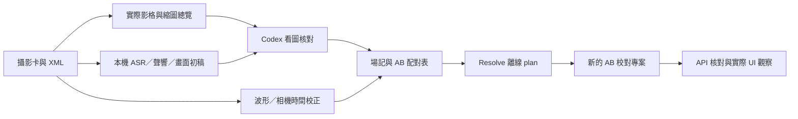

# 飲食紀錄片場記與雙機同步

可分享的 **Codex skill + Python CLI harness**：本機辨識對白與環境音、Codex 實際看圖核對、製作逐鏡場記與 AB 配對表，並在 DaVinci Resolve 建立 **A 機在下、同步 B 機在上**的校對時間線。MIT 開源。

English: A local-first food-documentary shot logging workflow with evidence-based native Codex visual review and a real DaVinci Resolve scripting adapter.

## 包含什麼

- 原始影片與 Sony XML 盤點，保留卡別、完整路徑、拍攝時間與慢動作倍率。
- 多聲道音量量測、本機 Whisper 分段逐字稿、有意義對白整理；原稿保留。
- 本機環境聲分類、選用本機 VL 畫面初稿／文字順稿。
- **Codex 閉源視覺模型的正式核對步驟**：實際開啟擷取影格，保存素材 ID、片內時間與圖片 hash。
- XLSX 場記、逐段對白／環境音、AB 同步對照；可接既有模板並另存新版本。
- 多段波形對齊、相機時鐘校正、無聲慢動作按實拍時間配對。
- 真正的 Resolve SDK 後端：新專案、V1 A／V2 B、marker、可續建、API readback、實際 UI 截圖紀錄、DRT／DRP 匯出。
- JSON 命令合約、快取、來源指紋、不可變 stage 工件、session head 與 trajectory。



## 安裝

需 Python 3.10+、ffmpeg／ffprobe。Resolve 功能另需已安裝且允許外部 scripting 的 DaVinci Resolve；**場記／辨識可獨立使用**。

```bash
git clone https://github.com/dog32903290/foood-skill.git
cd foood-skill
python3 -m venv .venv
source .venv/bin/activate
python -m pip install -e '.[asr]'
foodlog --json status
```

Windows 啟用 venv 使用 `.venv\Scripts\Activate.ps1`。ffmpeg 請由自己的套件管理器或[官方下載頁](https://ffmpeg.org/download.html)安裝。

選用依賴（按需要安裝）：

```bash
python -m pip install -e '.[environment]'  # AST 環境音候選
python -m pip install -e '.[mlx]'          # Apple Silicon MLX Whisper
python -m pip install -e '.[capture]'      # macOS Resolve 視窗自動發現
```

### 安裝 Codex skill

對 Codex 說：

> 使用 skill-installer，從 dog32903290/foood-skill 安裝 skills/food-shotlog-sync。

或手動把 `skills/food-shotlog-sync` **整個資料夾**複製到自己的 Codex skills 目錄（通常是 `~/.codex/skills/`），有同名 skill 時先保留舊版、另行處理，不直接覆蓋。依宿主的 skill 載入方式重新整理／重開會話。

skill 已自帶腳本；只複製 skill 的環境，仍需安裝對應 Python 依賴與 ffmpeg，可直接以該環境的 Python 執行 `scripts/foodlog_cli.py`。`foodlog` 入口則由 repo 的 pip 安裝提供。

安裝後可說：

> 使用 $food-shotlog-sync，替這批飲食紀錄片素材製作場記。先研究製程與店家背景，本機辨識原音、環境聲，再由你實際看圖核對；保留原檔，依我的範例另存新的場記表。

要做時間線時：

> 依最後核對的 AB 配對場記，在達芬奇新增校對專案；A 機放下面，同步的 B 機放上面，無原音的慢動作按表排。

## 最小工作流程

以下路徑全部換成自己的絕對路徑。`--config` 和 `--json` 放在子命令前。

### 1. 盤點與本機辨識

```bash
foodlog --json init --source-root /path/project/01_video --work-dir /path/project/outputs/run-001 --output /path/project/foodlog.local.json --card A001:A:A001 --card B001:B:B001
foodlog --json --config /path/project/foodlog.local.json inventory
foodlog --json --config /path/project/foodlog.local.json audio prepare
foodlog --json model-download faster-whisper small
foodlog --json --config /path/project/foodlog.local.json asr
# 選用：需先安裝 environment extra
foodlog --json model-download ast MIT/ast-finetuned-audioset-10-10-0.4593
foodlog --json --config /path/project/foodlog.local.json environment --backend ast
```

`small` 是省資源起點；中文人名、方言或吵雜訪談可用較大模型重跑指定鏡頭。Apple Silicon 可在 config 設 `asr.backend=mlx-whisper`、`asr.model=mlx-community/whisper-large-v3-turbo`，先執行對應 `model-download mlx-whisper`。

### 2. Codex 視覺核對與場記

```bash
foodlog --json --config /path/project/foodlog.local.json review pack
# 可選：先配置已有的本機 vision_model，再執行 review local
# 讓 Codex 實際開啟輸出的 contact sheets／影格，記錄觀察
foodlog --json --config /path/project/foodlog.local.json review import /path/project/codex-review.json
foodlog --json --config /path/project/foodlog.local.json sync
foodlog --json --config /path/project/foodlog.local.json sheet export --output /path/project/outputs/shotlog-new.xlsx
foodlog --json --config /path/project/foodlog.local.json validate
```

使用 [Codex 核對格式](skills/food-shotlog-sync/assets/codex-review.example.json)，填入實際觀察、影格路徑與 hash。**Python 不會透過隱藏 API 呼叫 Codex 閉源模型**；此階段由 Codex 宿主的看圖工具完成，使用者需有相應能力／額度。沒有看圖工具時只能交機器初稿，不能標已核對。

有舊場記模板時加 `--template /path/old.xlsx`。XLSX 輸出後仍需打開／渲染，檢查欄寬、換行與截斷；數值檢查不等於版面檢查。宿主有專用試算表工具時，依該工具的工作流程製作／檢視。

### 3. 達芬奇校對時間線（選用）

```bash
foodlog --json --config /path/project/foodlog.local.json sheet import-pairs /path/project/outputs/shotlog-new.xlsx
foodlog --json resolve status
foodlog --json --config /path/project/foodlog.local.json resolve plan
# 已要求建立時間線，並檢查離線 plan 後才執行
foodlog --json --config /path/project/foodlog.local.json resolve apply --execute
foodlog --json --config /path/project/foodlog.local.json resolve inspect
foodlog --json --config /path/project/foodlog.local.json resolve capture --output /path/project/outputs/evidence/resolve-001.png
```

存檔重開，**實際看 Resolve 截圖**，依 [UI 核對格式](skills/food-shotlog-sync/assets/resolve-ui-review.example.json)記錄後：

```bash
foodlog --json --config /path/project/foodlog.local.json resolve ui-review /path/project/ui-review.json
foodlog --json --config /path/project/foodlog.local.json resolve export --directory /path/project/outputs/resolve-export-001
```

中斷時用同 config `resolve apply --execute --resume` 續建，不清空重排。幀率／trim 不符或專案身份改變會停止。DRP／DRT 不包含原影片，換電腦需掛載或 relink。

## 省用量與證據界線

大量轉錄與分類在本機執行；先處理代表性短段，再跑整批。只有疑難段升級模型；圖像先看 contact sheet，關鍵動作再放大。已完成快取可重用，不把數百支影片反覆送入聊天。

Whisper 辨識對白，AST 列聲音候選，本機文字模型順稿，Codex 核對真實畫面。**看圖不能證明說了什麼，製程報導也不能證明鏡頭拍到什麼。** 背景研究保留連結；不確定的食材、人名、祖籍與方言回到原音／可信報導核對。

本機 VL／文字／音訊服務是選用，endpoint 限 localhost；不需要付費雲端 API key。支援服務的實際格式仍須確認，尤其音訊。這裡的 MIT 只涵蓋 repo 程式與文件；模型、依賴與 Resolve 各依原授權使用。

## 文件與適用範圍

- [Skill 入口與操作規則](skills/food-shotlog-sync/SKILL.md)
- [CLI／資料／配對工作表格式](skills/food-shotlog-sync/references/harness.md)
- [辨識、Codex 看圖、研究與成本](skills/food-shotlog-sync/references/recognition.md)
- [Resolve 慢動作、續建與 UI 核對](skills/food-shotlog-sync/references/resolve.md)
- [設定樣本](skills/food-shotlog-sync/assets/project.example.json)

流程來自 macOS、Sony 卡片 XML、29.97／59.94 與 Resolve Studio 21.1 的實際製作。公開版把專案路徑與內容移除，改成可設定的工具；其他硬體、模型服務、Resolve 版本與任意混合幀率未逐一實機驗證。發布檢查包含 Python 語法、CLI／skill 結構與唯讀後端連線；不宣稱公開重構版已在所有環境完成整批端到端執行。

原始素材與既有工作簿不刪不覆寫。來源變更請建立新 work；session head 與 checkpoint 只更新工具自己建立的狀態檔。公開 repo 不包含攝影素材、逐字稿、私人專案、模型權重或 Resolve SDK。

[MIT License](LICENSE)
